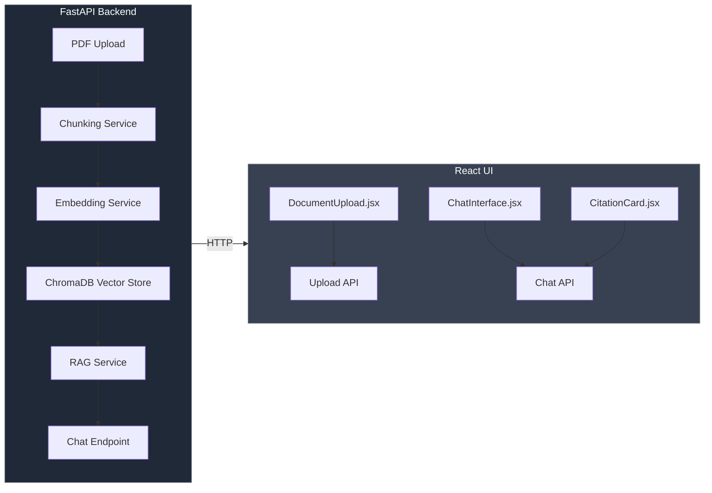

# AI Document Q&A Assistant (RAG)

## Overview
A Retrieval‑Augmented Generation (RAG) web application that lets users upload PDFs, ask questions, and receive answers with exact source citations (file name + page). The stack consists of:

- **Backend**: FastAPI, ChromaDB for vector storage, deterministic fallback embeddings (optional OpenAI embeddings via `.env`).
- **Frontend**: React + Vite, dark theme UI for document upload, session management, and chat with citation cards.
- **Containerisation**: Dockerfiles for backend and frontend, orchestrated with `docker‑compose`.

## Architecture


## Quick Start (Docker)
```bash
# Clone the repository and cd into the project root
git clone <repo-url>
cd "AI Document Q&A Assistant (RAG)"

# Create a .env file (see .env.example)
cp .env.example .env
# Edit .env to add your OpenAI API key if you want real embeddings

# Build and run containers
docker-compose up --build
```
The backend will be available at `http://localhost:8000` and the UI at `http://localhost`.

## Development
```bash
# Backend (virtualenv recommended)
python -m venv venv && source venv/bin/activate
pip install -r requirements.txt
uvicorn app.main:app --reload

# Frontend
cd frontend
npm install
npm run dev   # proxies /api to http://localhost:8000
```

## API Endpoints
| Method | Path | Description |
|---|---|---|
| `POST` | `/api/documents/upload` | Upload a PDF; returns document ID |
| `GET` | `/api/documents/{doc_id}` | Retrieve document metadata |
| `POST` | `/api/chat` | Send a question with `session_id`; returns answer with citations |
| `GET` | `/api/session/{session_id}` | Get chat history for a session |
| `GET` | `/health` | Liveness probe |

## Testing
```bash
pytest tests
```
The suite covers PDF extraction, chunking (including overlap), vector insertion, and RAG answer generation with citation validation.

## Environment Variables (`.env.example`)
```
# OpenAI API key (optional – deterministic fallback is used if missing)
OPENAI_API_KEY=
# Embedding model name for OpenAI (e.g., text-embedding-ada-002)
EMBEDDING_MODEL=text-embedding-ada-002
# LLM model for answering (e.g., gpt-4o-mini)
LLM_MODEL=gpt-4o-mini
# Rate limit: requests per minute per session
RATE_LIMIT_PER_MINUTE=20
```

## License
MIT © 2024‑2026 Antigravity Team
